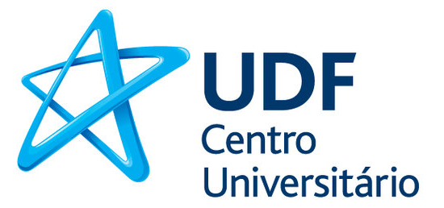

**Profa. Kadidja Valéria | UDF**  
Ciência de Dados e Aprendizado de Máquina · Sistemas de Informação · 2026.2

# Autoavaliação e conferência da entrega

## Identificação

- Estudante ou equipe: **Maria Eduarda Gonçalves Rodrigues**
- Turma: **Ciência de Dados e Aprendizagem de Máquina**
- Data de realização: **22/10/2026**
- Integrantes e contribuições (se em equipe): **Individual**

## Checklist

- [x] Diferenciei IA, Ciência de Dados e ML com um exemplo.
- [x] Completei o quadro supervisionado/não supervisionado.
- [x] Justifiquei pelo menos cinco situações-problema.
- [x] Registrei a investigação da biblioteca.
- [x] Identifiquei atributos, alvo, unidade e momento da previsão.
- [x] Executei e documentei a prática em Python ou Orange.
- [x] Escolhi configurações usando treino/validação.
- [x] Mantive o teste fora do ajuste e da seleção.
- [x] Interpretei acurácia, matriz, MAE e R².
- [x] Comparei com uma referência e discuti erros.
- [x] Registrei limitações, dados sintéticos, privacidade e vieses.
- [x] Formulei recomendações de apoio com revisão humana.
- [x] Respondi às questões individuais.
- [x] Conferi os links e os arquivos de evidências.
- [x] Substituí os campos PREENCHER ou justifiquei os não aplicáveis.

## Reflexão individual

## Reflexão individual

- **O que aprendi e consigo explicar:** Aprendi como os dados podem ajudar a identificar problemas e melhorar o funcionamento de uma biblioteca. Também consigo explicar a diferença entre análise descritiva e Machine Learning e como os dados podem ser utilizados para prever a quantidade de atendimentos.

- **Qual foi minha principal dificuldade:** Minha principal dificuldade foi entender quando realmente é necessário utilizar Machine Learning e quando uma análise simples com tabelas e gráficos já consegue resolver o problema.

- **Qual evidência mostra meu avanço:** Consegui identificar o problema da biblioteca, definir perguntas de negócio, escolher os atributos necessários e propor uma forma de avaliar os resultados.

- **Como contribuí com a equipe:** Contribuí com a elaboração da proposta, a identificação dos dados necessários e a escolha de uma abordagem para ajudar a reduzir as filas e melhorar a utilização dos serviços.

- **O que preciso revisar:** Preciso revisar os conceitos de aprendizado supervisionado e não supervisionado, regressão e avaliação de modelos, para entender melhor quando cada abordagem deve ser utilizada.

- **Ferramentas de apoio utilizadas, incluindo IA quando houver, e como verifiquei as respostas:** Utilizei o ChatGPT como ferramenta de apoio para organizar as ideias, compreender os conceitos e estruturar as respostas. Verifiquei se as sugestões estavam de acordo com o enunciado da atividade e revisei o conteúdo para compreender as justificativas apresentadas.

## Critérios de avaliação

Escala sugerida do material: nível 3 consistente, 2 adequado com lacunas, 1 parcial, 0 ausente/incoerente. Nota do critério = peso × nível/3. A professora pode ajustar a aplicação.

| Critério | Peso aula 1 | Peso aula 2/PBL |
| --- | --- | --- |
| Problema e conceitos | 3,0 | 2,0 |
| Dados e justificativa | 2,0 | 2,0 |
| Método e avaliação | 1,0 | 3,0 |
| Interpretação e responsabilidade | 2,0 | 2,0 |
| Clareza e colaboração | 2,0 | 1,0 |
| Total | 10,0 | 10,0 |

Na aula 1, método corresponde à avaliação proposta. Na aula 2, inclui execução e interpretação. A maior acurácia isolada não assegura a melhor avaliação da atividade.

## Fontes de apoio

- SCIKIT-LEARN. *User Guide*. https://scikit-learn.org/stable/user_guide.html.
- SCIKIT-LEARN. *Common pitfalls and recommended practices*. https://scikit-learn.org/stable/common_pitfalls.html.
- ORANGE DATA MINING. *Test and Score*. https://orangedatamining.com/widget-catalog/evaluate/testandscore/.

Referências indicadas no material didático do módulo, consultadas em 14 out. 2026. Registre a data da sua própria consulta quando utilizar novas fontes.

[Voltar ao início](README.md).
